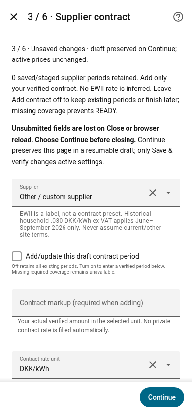
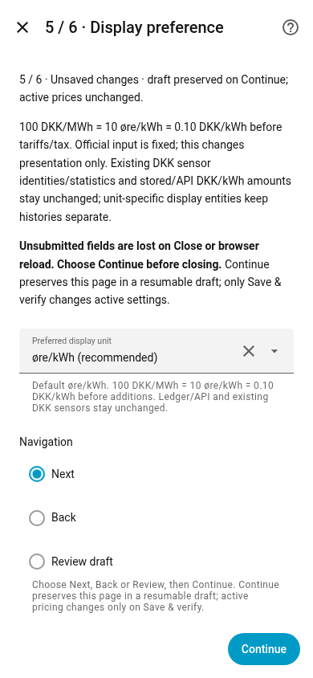
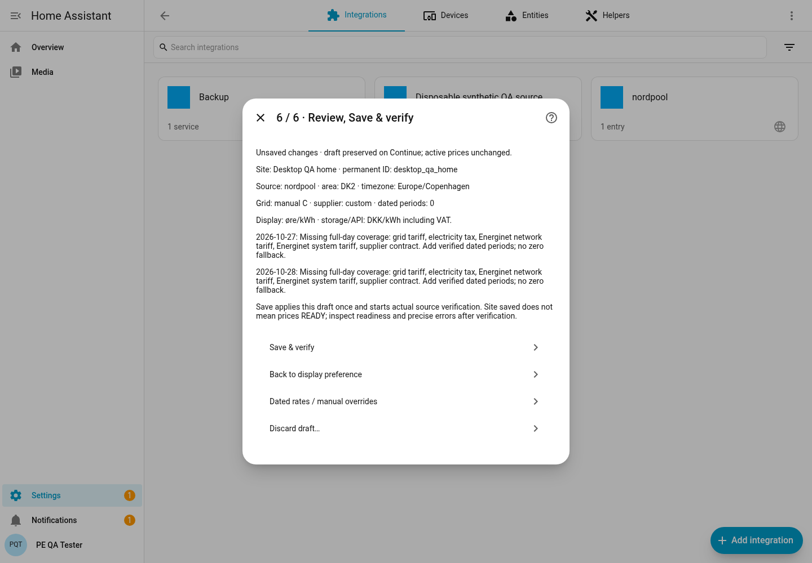

# Guided setup: beta.2

Open **Settings → Devices & services → Energy Price Engine → Configure** for an
existing beta.1 site. Use **Add integration → Energy Price Engine** only for a new
independent site. Do not delete an existing entry to upgrade it.

The native Home Assistant wizard has six stages. On each form choose **Next**,
**Back** or **Review draft**, then press **Continue**. Continue saves a separate
resumable draft. Final **Save & verify** applies it once; **Discard draft…** needs
explicit confirmation. Existing rates, source references, permanent IDs and price
history survive opening the wizard and renaming a site.

**Before closing: press Continue.** Home Assistant's native Close button and browser
reload do not submit fields still being typed. A bold warning appears on every
page. Submitted fields, invalid submissions and Back edits are retained across
closing/restarting. The integration cannot autosave unsubmitted keystrokes through
HA's native config-flow API. Avoid simultaneous editing flows for the same site.

## 1. Site and official Nord Pool

- Enter a readable name. The optional ID can be blank; PE generates a unique ID.
  An existing ID remains stable when the name changes.
- Choose **Official Home Assistant Nord Pool**. Only its readable integration
  selector appears; there is no entity/unit/basis form to complete.
- Configure official Nord Pool in Devices & services first if it is absent. PE
  rejects a legacy custom component shadowing the official integration.
- Confirm the area's hint from the selected source: DK2 when available, Copenhagen
  for Danish areas. No address, grid product or private contract is inferred.
- Input is fixed **DKK/MWh excluding VAT**. Enter VAT as **25** for 25%. Display
  units are chosen later. Example: 100 DKK/MWh = 10 øre/kWh before additions.

## 2. Grid tariffs

Select **Automatic: verified Radius C** only for a confirmed Radius C connection.
Keep class C; automatic verification checks identity, dates and quarter coverage.
Other classes use verified dated manual rates. The optional manual fallback needs
its own valid coverage. Unknown or expired tariffs never turn into zeros.

## 3. Supplier contract

EWII is a label, not a preset rate. Turn **Add/update this draft contract period**
on only when adding a verified rule, then enter amount/unit, VAT inclusion and
percentage, start/end dates, verification date and source. End dates are exclusive.
Existing saved periods remain retained; advanced Review edits can split/replace
periods without losing the old dates. Equal-priority overlaps are rejected.

**Example — summer house in DK2:** give it a separate site ID and select its actual
Nord Pool source and grid product. Leave Add contract off until its own contract is
known. PE permits saving this incomplete site but prices remain unavailable. Never
copy household rates. The documented household EWII 0.030 DKK/kWh ex-VAT fact is
**2026-06-01 through 2026-09-30 only**, not October/current or summer-house terms.

The mobile page scrolls; Continue stays at the bottom. These are synthetic QA data,
not an owner's installation or contract.

## 4. Energinet, electricity tax and heating

Opt into documented bounded national components or configure explicit dated manual
rules through Review. The bounded baseline contains 2026 Energinet network/system
0.043/0.072 DKK/kWh ex VAT and 2026–2027 electricity tax 0.008 ex VAT. It invents no
future period. Manual locks/overrides are retained.

Heating registration is never inferred from a heat pump. Any eligible rate needs
an explicit verified rule plus registration, matching usage year and actual annual
consumption evidence. Checking registration alone creates no discount.

## 5. Display preferences

Default **øre/kWh** is presentation only. Original DKK/kWh entities, statistics,
SQLite amounts and CM API v1 are unchanged. Five additional display sensors cover
current/next/min/max/average. Changing preference activates the other unit-specific
entity family; previous statistics are never reinterpreted as another unit.

## 6. Review, Save & verify

Review lists site/source/area/timezone, grid, supplier, display and missing coverage
for today/tomorrow. **Dated rates / manual overrides** opens advanced rates,
time bands, locks, monthly subscriptions, stored-price breakdown and storage/backup
operations. Return to Review to apply the complete draft. Save returns to any page
with preserved, unapplied fields instead of silently omitting them.

**Saved is not READY.** Verification runs after Save. Inspect the site's readiness
entity attributes: missing components, affected date/offset, source/verification
error and corrective action. Add the verified dated period and save again. Missing
components keep current and preferred-display prices unknown; there is no zero fallback.

Device info shows software version from the installed manifest. After HACS update
and restart it must show **0.1.0-beta.2**. Existing incomplete sites can resume through
Configure; a completed site can use the same wizard for later changes.

## QA scope

Real HA 2026.10.4 frontend 20260930.5 was exercised using Playwright and system
Chromium at desktop 1440×1000 and mobile 390×844. The Browser plugin was unavailable.
The fixture supplies recorded/synthetic read-only Nord Pool quarters and disables
live grid requests; only decorative external brand icons are substituted to avoid
unavailable network requests blocking frontend JS. Tests exercise native HA dialogs,
not reconstructed HTML. A minimal-fixture HA unknown-command rejection and optional
camera libturbojpeg warning are fixture limitations, not evidence of owner HA health.
No PAHA02-DEV login, physical-device testing or Raspberry Pi performance claim.

See [HACS update steps](HACS_DISTRIBUTION.md), [component/storage details](BETA_SETUP.md)
and [acceptance checklist](BETA_ACCEPTANCE.md).
