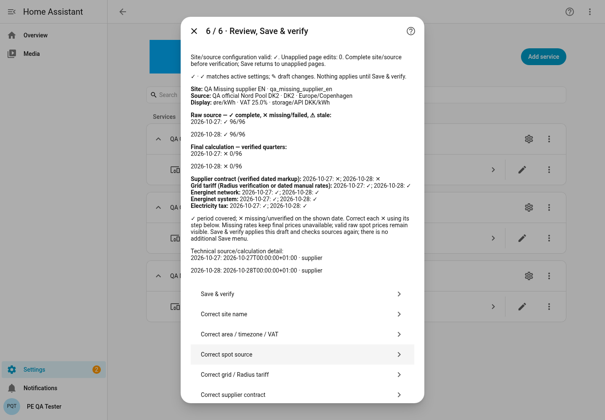
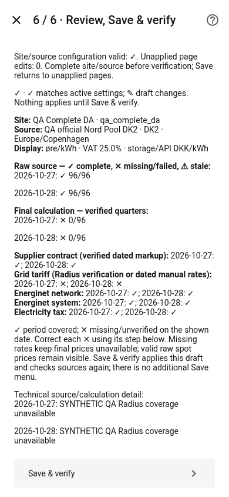
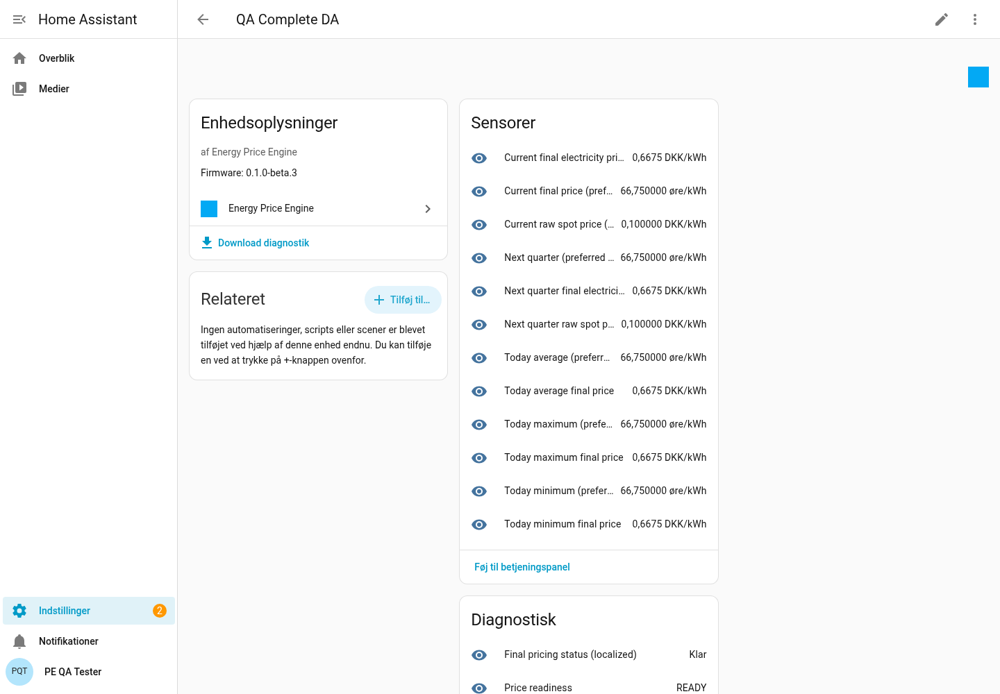
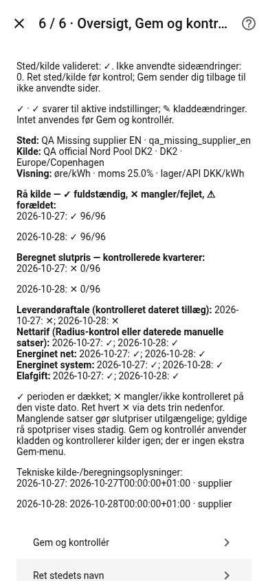

# Beta.3: configure, verify and retest

Beta.1 and beta.2 failed owner acceptance. This beta is for focused PAHA02-DEV
retesting, not a claim that the owner's installation has passed.

Update through HACS: enable **Show beta versions**, select **v0.1.0-beta.3**, download
and restart. Keep the beta subscription enabled; [HACS update explanation](HACS_DISTRIBUTION.md#beta3-retest-and-the-short-hash-update-card).
Check Device info shows **0.1.0-beta.3**. Existing site: **Devices & services → Energy
Price Engine → Configure**. Do not delete/recreate it. Add integration creates a
separate site, not an upgrade. Source mappings, contracts, IDs, entities and SQLite
history are retained.

## Six native stages

Choose Next/Back/Review and press **Continue / Fortsæt**. Continue preserves a
separate draft; **Save & verify / Gem og kontrollér** applies it. Close/reload cannot
submit fields still being typed: Continue first. Invalid submissions and Back edits
are retained. Discard requires explicit confirmation. Avoid simultaneous editing
flows on the same site.

1. **Site and source / Sted og kilde.** Enter a friendly name; leave optional ID
   blank for an automatic unique stable ID. Select your installed official Nord
   Pool by name. Only advanced entity providers see entity/unit/verification fields.
   Confirm source-supported DK2 and Copenhagen hints, and **25** for 25% VAT.
   Official input is fixed DKK/MWh excluding VAT, not your display preference.
   After confirmation the next page displays actual raw-source quarter coverage.
2. **Grid / Nettarif.** Confirm your actual grid product before choosing automatic
   Radius C. C is a connection/tariff class. DK2 alone does not prove Radius. Review
   retrieves the real dated tariff and checks coverage. Other classes use verified
   dated manual rules through Review → Advanced. No private grid product is guessed.
3. **Supplier / Leverandør.** EWII is a label, not a contract preset. Required:
   actual per-kWh markup, unit, VAT inclusion/percentage, inclusive start date,
   exclusive end date, verification date and reference. Enable Add/update contract
   to enter these fields; leave it off to retain existing periods or save incomplete.
   Choose dates with HA's calendar controls. No amount is filled automatically.
4. **National charges / Energinet og elafgift.** New Danish official-source sites
   suggest a visible documented bounded baseline: 2026 Energinet .043/.072 DKK/kWh
   ex VAT and 2026–2027 electricity tax .008. Existing choices stay unchanged. This
   is documented data, not live legislative discovery. Manual verified periods and
   locks remain available. Heating registration alone creates no discount: an
   explicit eligible rule, evidence, year and consumption are required.
5. **Display / Visning.** Default øre/kWh for preferred-display sensors. Input
   100 DKK/MWh = .100 DKK/kWh = 10 øre/kWh before additions. Original DKK sensors,
   SQLite values and read-only CM API stay canonical; changing display units does
   not reinterpret old statistics.
6. **Review / Oversigt.** The real adapters and canonical calculator check both
   days. See raw quarter counts, calculated final counts, and dated coverage for
   supplier, grid, Energinet and tax. ✓ means covered, ✕ identifies missing/failed
   data. Choose the named correction step directly. **Save & verify** is the first
   action; there is no separate hidden Save. It rechecks and persists configuration.

Review calculation is a transient preview with no draft ledger writes. After Save,
check the actual runtime status and slot counts: disk/source failures can still
prevent persistence, and preview success must never override that failure.

## What to check after Save

| Observation | Meaning and action |
| --- | --- |
| Raw READY 96, final READY 96 | Normal complete day. Verify final components/units against your actual contract. DST days legitimately have 92 or 100 quarters. |
| Raw READY 96, final INCOMPLETE 0, supplier problem | Nord Pool works. Enter the actual verified supplier period shown as missing; do not change input units or invent a zero markup. |
| Raw READY, final ERROR, grid problem | Radius coverage/verification failed. Recheck the grid source or enter explicitly verified manual rates. |
| Raw INCOMPLETE | Selected area/date has incomplete intervals. Check official Nord Pool, publication time and missing source quarters. |
| Raw STALE after refresh failure | Cached source retains its original verification timestamp, expires within two hours, and is not fresh READY evidence. Final API remains unavailable. |
| Storage problem | Preserve history, check free space/permissions, use verified backup/recovery instructions. Do not delete the ledger or certify preview prices as persisted. |

The raw sensors show current/next spot in DKK/kWh **before additions** plus coverage
and timestamps. They remain observable when final composition is blocked. Inspect
**Final pricing status (localized)** and **Pricing problem — corrective action**.
Legacy readiness codes remain uppercase for compatibility. The same native enum
messages are localized in Danish. Technical attributes include affected period,
missing component IDs, source detail and corrective action. Device info shows the
installed manifest version.

HA entity *names* use the system language/existing registry, standard HA behavior;
profile changes do not rename them globally. Wizard text, native selectors, validation,
Repairs and new enum state messages use the individual user's UI language. Both name
resource sets are included. Technical keys/provider exception text retain their
original conventions. No unsupported frontend/core patch is installed.

## Focused owner retest — PAHA02-DEV

1. Back up first. Record HA/HACS/PE versions and chosen site ID. Upgrade existing
   site in place; verify names, Nord Pool mapping, dated overrides and old history.
2. Switch the **user profile** between English and Danish; reopen Configure.
   Check the wizard and status messages, without changing the site's geography.
3. Confirm raw-source area, 15-minute coverage and verification timestamps. If
   source fails, use its exact diagnostic; valid supplier rates cannot fix a bad source.
4. Confirm actual grid product and supplier terms. For a DK2 summer house create
   its own independent site and use its own contract. The EWII household .030 ex-VAT
   fact is **June–September 2026 only**, never a current/future/summer-house default.
5. Review all dated checks. Save. Record raw and final valid/expected quarters and
   one stored price breakdown. Unknown inputs must be identified, never set to zero.
6. Close after Continue, resume, then restart. Verify same site/source/history and
   manifest version. Keep HACS beta visibility on and confirm semantic latest version,
   not a short main hash. PE's published-release entity is read-only; install via HACS.
7. Attach redacted PE diagnostics and the affected stage/status if acceptance fails.
   Do not include account numbers, addresses, tokens or unrelated integration videos.

No production HA, Node-RED, Tesla, Easee or charging controls are touched. Cloud
benchmarks do not establish Raspberry Pi performance; historical memory use remains
as documented in PERFORMANCE.md. Owner source/billing/hardware acceptance is separate.

## Simulated evidence and screenshots

Real disposable HA 2026.10.4/frontend 20260930.5, system English, user UI EN then DA.
Playwright/system Chromium (Browser plugin unavailable), desktop 1440×1000 and mobile
390×844. Core person/recorder are enabled so the native frontend is exercised normally;
only decorative external brand images are substituted. Source data and Radius rates
are explicitly synthetic, not owner data or live provider verification.

Complete GUI fixture: spot .100 + grid .200 + **fictional supplier .111** + .043 +
.072 + .008 = .534 ex VAT; × 1.25 = **.6675 DKK/kWh**, **66.75 øre/kWh**. Both days
contain 96 persisted quarters (192 per site). Do not copy the fictional contract.
Separate runtime tests use negative spot and normal/92/100-slot days, missing
supplier/national periods, source/Radius/ledger errors, and actual beta.1/.2 upgrade
fixtures. Browser evidence and mocked sources do not establish PAHA02-DEV success.

| Stage | English native UI | Dansk brugerflade |
| --- | --- | --- |
| Site | [Site](images/beta3/site-en.png) | [Sted](images/beta3/site-da.png) |
| Grid | [Grid and source verification](images/beta3/grid-en.png) | [Nettarif](images/beta3/grid-da.png) |
| Supplier | [Supplier requirements](images/beta3/supplier-en.png) | [Leverandøraftale](images/beta3/supplier-da.png) |
| National | [National components](images/beta3/charges-en.png) | [Energinet og afgift](images/beta3/charges-da.png) |
| Display | [Display](images/beta3/display-en.png) | [Visning](images/beta3/display-da.png) |
| Complete | [96-quarter calculation](images/beta3/complete-review-en.png) | [Kontrolleret beregning](images/beta3/complete-review-da.png) |

[Machine-readable synthetic runtime/ledger evidence](receipts/v0.1.0-beta.3-simulation.json).

